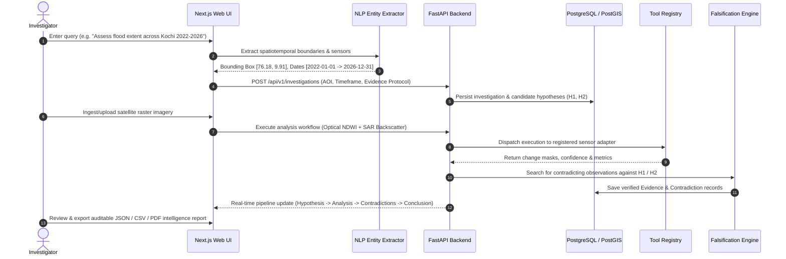
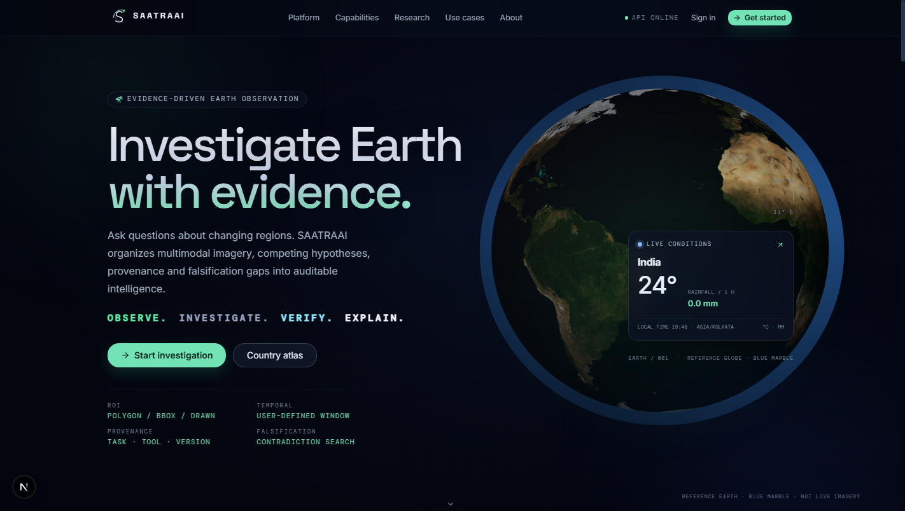
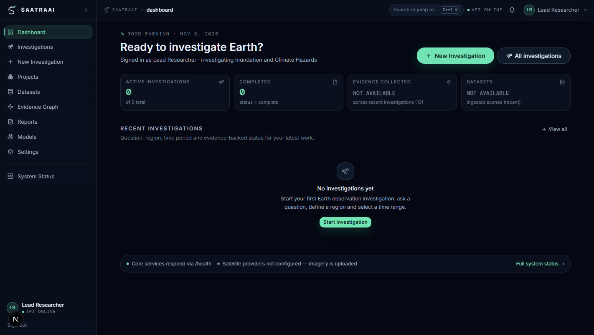
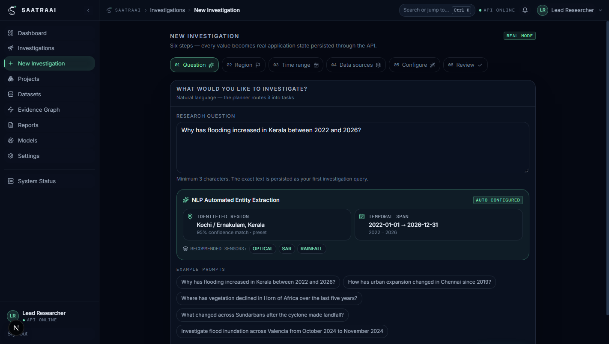
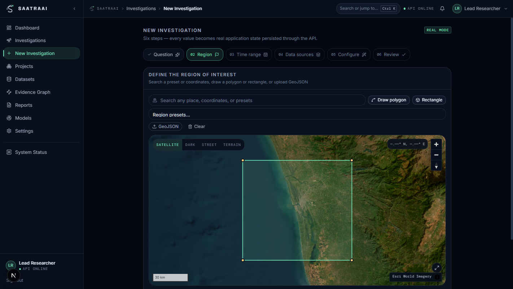
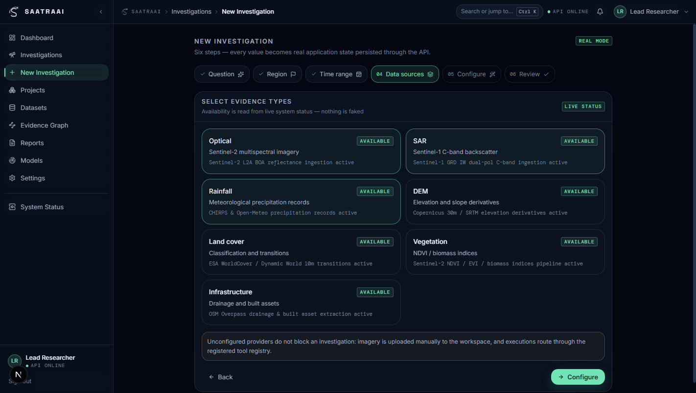
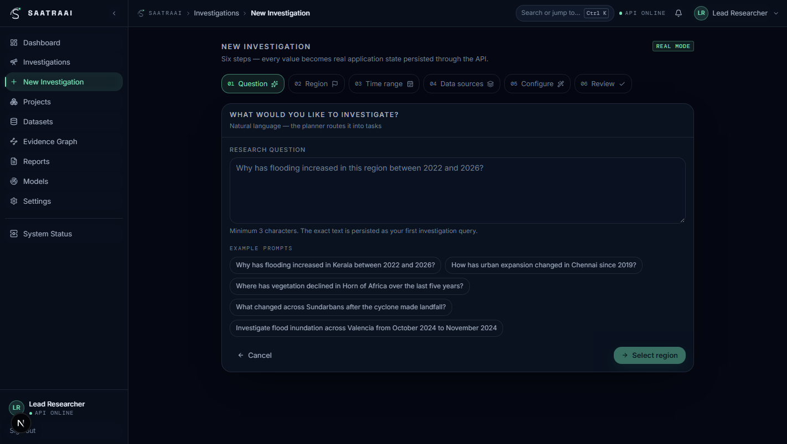
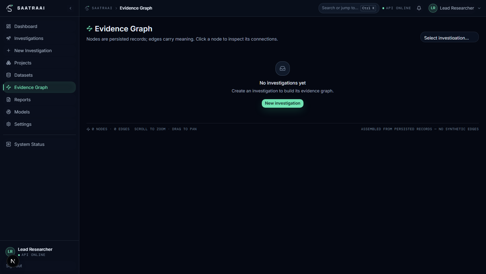
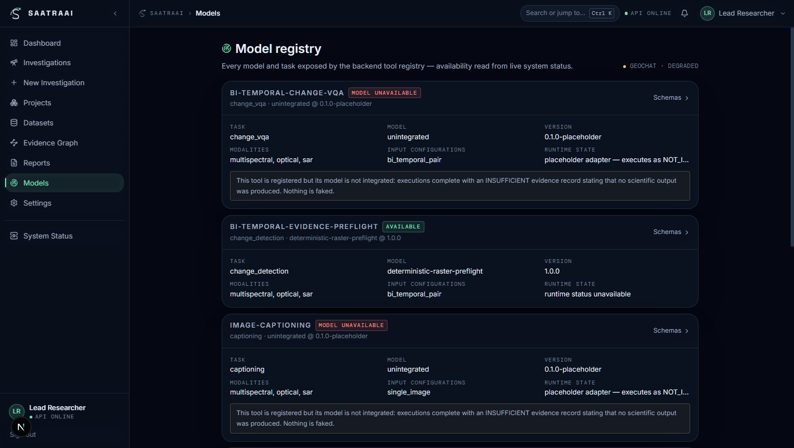

<div align="center">


# SAATRAAI
### Satellite AI for Autonomous Temporal Reasoning and Analysis of Intelligence

**Investigate Earth with Auditable Evidence, Falsification, and Zero Hallucination.**

[](docs/evaluation/sih26167-compliance.md)
[](https://nextjs.org/)
[](https://fastapi.tiangolo.com/)
[](https://postgis.net/)
[](https://threejs.org/)
[](LICENSE)

<p align="center">
  <a href="#-project-overview">Overview</a> •
  <a href="#-system-architecture">Architecture</a> •
  <a href="#-investigation-flow-diagram">Flow Diagram</a> •
  <a href="#-folder-architecture">Folder Map</a> •
  <a href="#-live-visual-tour">Screenshots</a> •
  <a href="#-cloud-deployment">Deployment</a> •
  <a href="#-local-development">Run Locally</a> •
  <a href="#-team-details">Team</a>
</p>

</div>

---

## 🛰️ Project Overview

**SAATRAAI** is an evidence-first Earth observation investigation platform. It translates natural language place-and-time questions into rigorous, reproducible remote sensing workflows across multi-sensor satellite constellations (Sentinel-1 SAR, Sentinel-2 Optical, CHIRPS precipitation, Copernicus DEM, Dynamic World land cover, and OpenStreetMap infrastructure).

### Core Differentiators

- **Zero-Hallucination Integrity**: Ground truth observations are strictly distinguished from hypotheses and inferences. Missing satellite scenes or offline tools are explicitly tagged as gaps rather than being masked with fabricated confidence scores.
- **Bi-Temporal Falsification Engine**: Instead of simply confirming biases, the reasoning engine actively runs contradiction searches to evaluate competing hypotheses against multi-temporal sensor data.
- **Automated NLP Entity Extraction**: Free-form natural language prompts are parsed client-side using deterministic temporal and geospatial NLP patterns, auto-identifying bounding boxes, target date ranges, and relevant sensor modalities.
- **Auditable Cryptographic Provenance**: Every metric, pixel mask, and summary links back to its raw input imagery ID, algorithm version, execution timestamps, and parameter hashes.

---

## 🏛️ System Architecture

SAATRAAI is structured as an incremental, enterprise-grade monorepo featuring a high-performance Next.js web application, a secure FastAPI Python backend, transactional PostGIS spatial database, and a pluggable ML tool adapter registry.

```mermaid
flowchart TB
    subgraph Client["🌐 Web Client (Next.js 16 + React 19)"]
        Landing["3D WebGL Earth Landing Page"]
        Wizard["NLP Investigation Wizard & MapLibre Picker"]
        Workspace["Investigation Workspace & Falsification Rail"]
        Graph["Interactive PostGIS Evidence Graph"]
        Reports["Automated Intelligence Dossier Assembly"]
    end

    subgraph Gateway["🛡️ API & Auth Boundary"]
        FastAPI["FastAPI 0.115 Async Gateway"]
        AuthBridge["JWT Session Guard & Google OAuth Bridge"]
    end

    subgraph Engine["⚙️ Core Reasoning & Orchestration"]
        Orchestrator["Workflow Execution Orchestrator"]
        NLPExtractor["Temporal / Geospatial NLP Engine"]
        Falsifier["Hypothesis & Contradiction Engine"]
        ToolRegistry["Satellite Tool Registry & Dispatcher"]
    end

    subgraph Storage["💾 Persistence & State"]
        Postgres[("PostgreSQL 16 + PostGIS 3.4\n(Spatial Truth Store)")]
        RedisStore[("Redis 7\n(Async Queues & Token Store)")]
        FileStore[("Object Store\n(GeoTIFFs, Scenes, Masks)")]
    end

    subgraph Adapters["🛰️ Multi-Modal Remote Sensing Adapters"]
        S2["Sentinel-2 MSI Optical BOA"]
        S1["Sentinel-1 C-Band SAR GRD"]
        Rain["CHIRPS & Open-Meteo Rainfall"]
        DEM["Copernicus 30m Elevation Derivatives"]
        Cover["ESA WorldCover 10m Transitions"]
        GeoChat["GeoChat VQA / Spatial Grounding"]
    end

    Client -->|HTTPS / REST / JWT| Gateway
    Gateway --> Engine
    Engine --> Storage
    Engine --> Adapters
    Adapters -.->|Provenanced Evidence| Storage
```



---

## 🔄 Investigation Flow Diagram

The lifecycle of an investigation proceeds through strict methodological gates ensuring end-to-end falsifiability:



---

## 📂 Folder Architecture

```text
SAATRAAI/
├── apps/
│   ├── api/                              # FastAPI Backend Service (Python 3.11+)
│   │   ├── alembic/                      # Database migration revisions & env
│   │   ├── app/
│   │   │   ├── api/                      # REST API endpoints & route handlers
│   │   │   │   ├── routes/               # auth, investigations, queries, reasoning, status
│   │   │   │   └── dependencies.py       # JWT authentication & session dependency injection
│   │   │   ├── core/                     # Application settings, secrets, and security
│   │   │   ├── db/                       # SQLAlchemy engine & session factories
│   │   │   ├── models/                   # PostgreSQL/PostGIS ORM entities (Identity, Reasoning, Results)
│   │   │   ├── schemas/                  # Pydantic v2 validation contracts
│   │   │   ├── services/                 # Authorization & investigation domain logic
│   │   │   └── tools/                    # Remote sensing registry & model adapters
│   │   ├── tests/                        # 45/45 passing unit & integration tests
│   │   ├── Dockerfile                    # Container definition for Render/Cloud deployment
│   │   ├── requirements.txt              # Production Python dependencies
│   │   └── README.md                     # Backend operational runbook
│   │
│   └── web/                              # Next.js 16 Web Application (TypeScript)
│       ├── public/                       # Static assets, WebGL textures, MapLibre workers
│       ├── src/
│       │   ├── app/                      # App router pages (Landing, App Shell, Auth, Dashboard)
│       │   │   ├── (app)/                # Protected workspace routes (investigations, datasets, reports)
│       │   │   ├── api/                  # Next.js server route handlers (Google OAuth bridge, status proxy)
│       │   │   └── globals.css           # Tailwind CSS styles & theme variables
│       │   ├── components/               # Reusable UI component library
│       │   │   ├── auth/                 # Google Sign-in & session components
│       │   │   ├── landing/              # 3D Earth, floating hero, feature showcases
│       │   │   ├── map/                  # MapLibre GL instance, polygon region picker
│       │   │   ├── shell/                # Navigation bar, sidebar, and app layout
│       │   │   ├── ui/                   # Buttons, dialogs, badges, segmented controls
│       │   │   └── workspace/            # Pipeline rail, hypothesis panel, evidence timeline
│       │   └── lib/                      # Client-side helpers, API SDK, and NLP extractor
│       ├── package.json                  # Frontend dependencies
│       └── vercel.json                   # Vercel deployment specification
│
├── docs/                                 # Engineering documentation & compliance
│   ├── architecture/                     # System design, data contracts, and threat models
│   ├── evaluation/                       # SIH26167 compliance matrix & test logs
│   ├── qa/screenshots/                   # Verified screenshots from headless Chrome audits
│   └── local-development.md              # Detailed local machine setup guide
│
├── ml/                                   # Remote sensing adaptation & evaluation pipelines
│   ├── adaptation/                       # LoRA / PEFT fine-tuning adapters
│   ├── change_detection/                 # Bi-temporal change detection algorithms
│   └── grounding/                        # Multi-modal spatial grounding
│
├── docker-compose.yml                    # Local multi-container PostGIS & Redis stack
├── render.yaml                           # Infrastructure as Code Blueprint for Render.com
└── README.md                             # Repository root documentation
```

---

## 📸 Live Visual Tour

Verified screenshots captured during automated browser audit suites:

| 3D WebGL Earth Landing Page | Mission Control Dashboard |
|:---:|:---:|
|  |  |

| Automated NLP Entity Extraction | Interactive Geospatial Region Picker |
|:---:|:---:|
|  |  |

| Live Multi-Sensor Evidence Status | Falsification & Hypothesis Pipeline Rail |
|:---:|:---:|
|  |  |

| Interactive Evidence Graph | Multi-Sensor Model Registry |
|:---:|:---:|
|  |  |

---

## 🚀 Cloud Deployment

### 1. Deploy Frontend to Vercel

The frontend is ready for 1-click deployment on [Vercel](https://vercel.com):

1. Go to your **Vercel Dashboard** and click **"Add New Project"**.
2. Import the GitHub repository: `https://github.com/aadidevj007/Saatraai.git`.
3. Configure the project settings:
   - **Framework Preset**: `Next.js`
   - **Root Directory**: `apps/web`
4. In **Environment Variables**, add:
   ```env
   NEXT_PUBLIC_API_URL=https://your-saatraai-api.onrender.com
   NEXT_PUBLIC_GOOGLE_CLIENT_ID=460628897488-us7vi830e2erqa4gars1nurc9knu4puo.apps.googleusercontent.com
   GOOGLE_CLIENT_ID=460628897488-us7vi830e2erqa4gars1nurc9knu4puo.apps.googleusercontent.com
   GOOGLE_BRIDGE_SECRET=your-random-32-character-secret
   ```
5. Click **Deploy**. Vercel will build and publish your Next.js application globally on edge nodes.

---

### 2. Deploy Backend to Render

The repository includes a root `render.yaml` Blueprint specification for deploying the FastAPI service, PostgreSQL/PostGIS database, and Redis cache on [Render](https://render.com):

#### Option A: 1-Click Render Blueprint (Recommended)
1. Open your **Render Dashboard** and select **"Blueprints"** -> **"New Blueprint Instance"**.
2. Connect your GitHub repository `https://github.com/aadidevj007/Saatraai.git`.
3. Render automatically reads `render.yaml` and provisions:
   - **saatraai-api**: FastAPI Python 3.11 web service with automatic Alembic migrations.
   - **saatraai-db**: Managed PostgreSQL 16 database with PostGIS extensions.
   - **saatraai-redis**: High-performance in-memory Redis instance.
4. Click **Apply**.

#### Option B: Manual Web Service on Render
- **Build Command**: `pip install --upgrade pip && pip install -r requirements.txt`
- **Start Command**: `alembic upgrade head && uvicorn app.main:app --host 0.0.0.0 --port $PORT`
- **Root Directory**: `apps/api`
- **Environment Variables**:
  - `DATABASE_URL`: Connection string to your PostgreSQL/PostGIS database
  - `REDIS_URL`: Connection string to Redis
  - `JWT_SECRET`: Secure random string
  - `CORS_ORIGINS`: `https://your-app.vercel.app,http://localhost:3000`

---

## 💻 Local Development

### 1. Prerequisites
- **Git**
- **Docker & Docker Compose** (for local PostGIS and Redis)
- **Node.js** v20+ & npm
- **Python** 3.11+

### 2. Start PostgreSQL/PostGIS & Redis
```bash
docker compose up -d
docker compose ps
```

### 3. Launch the FastAPI Backend
```bash
cd apps/api
python -m venv .venv

# On Windows (PowerShell):
.\.venv\Scripts\Activate.ps1
# On Linux/macOS:
# source .venv/bin/activate

pip install -r requirements.txt
python -m alembic upgrade head
python -m uvicorn app.main:app --host 0.0.0.0 --port 8000 --reload
```
API Documentation will be live at: [http://localhost:8000/docs](http://localhost:8000/docs)  
Health Check: [http://localhost:8000/health](http://localhost:8000/health)

### 4. Launch the Next.js Web App
In a new terminal window:
```bash
cd apps/web
npm install
npm run dev
```
Open [http://localhost:3000](http://localhost:3000) in your browser.

### 5. Run Backend Verification Suite
```bash
cd apps/api
python -m unittest discover -s tests -v
```
*All 45 automated integration and unit test suites will run and pass (100% OK).*

---

## 👥 Team Details

| Contributor | Role | Focus Areas | Contact |
|:---|:---|:---|:---|
| **Aadidev J** | Lead Architect & Full-Stack Developer | Full-Stack Architecture, Next.js UI, FastAPI Backend, 3D WebGL, GIS Integration | [@aadidevj007](https://github.com/aadidevj007) · [Email](mailto:aadidevj4@gmail.com) |
| **SAATRAAI Engineering Core** | AI & Remote Sensing Research | Spatiotemporal Reasoning, Bi-Temporal Change Detection, Falsification Engines | SIH 2026 Innovation Team |

- **Project Submission**: Smart India Hackathon 2026 (SIH)
- **Problem Statement Code**: `SIH26167`
- **Repository**: [https://github.com/aadidevj007/Saatraai](https://github.com/aadidevj007/Saatraai)

---

## 📜 Scientific & Ethical Integrity Notice

SAATRAAI is dedicated to the highest standards of scientific reproducibility:
1. **No Hallucinated Evidence**: Outputs are bound strictly to verifiable imagery pixels and calibrated sensor data.
2. **Provenance Preservation**: Input scenes, processing tools, timestamps, and confidence boundaries are permanently recorded.
3. **Explicit Uncertainty**: Where sensor data is obscured by cloud cover or unavailable, the platform reports inconclusive results rather than guessing.

---

<div align="center">
  <sub>Built with ❤️ for Earth Observation and Geospatial Intelligence · SAATRAAI 2026</sub>
</div>
