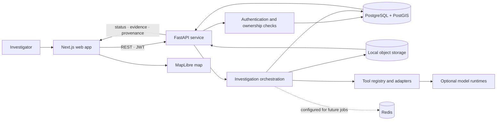
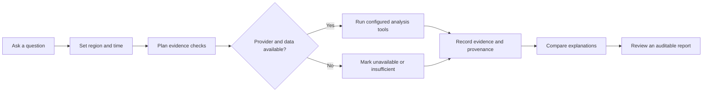
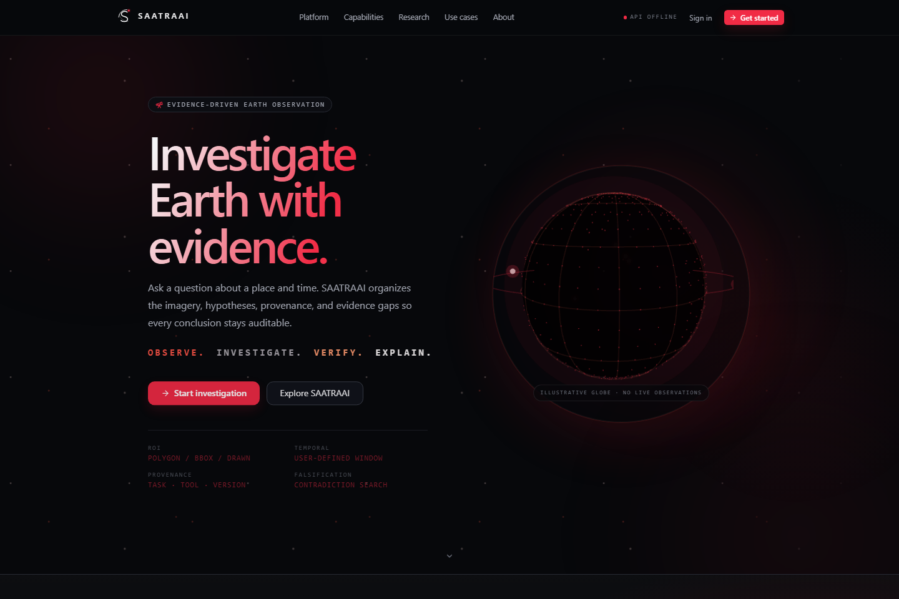
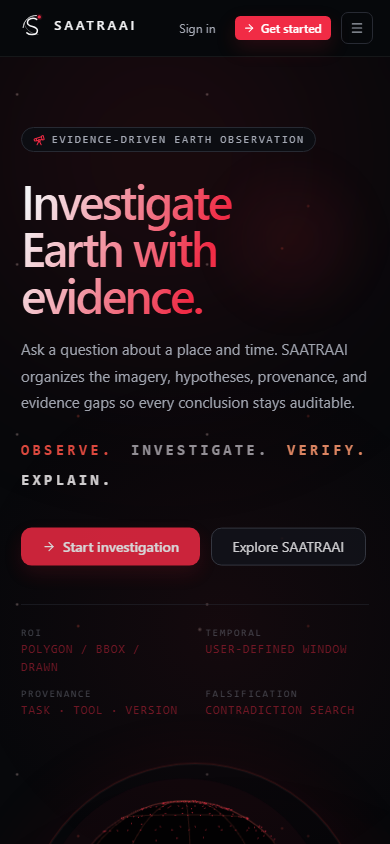
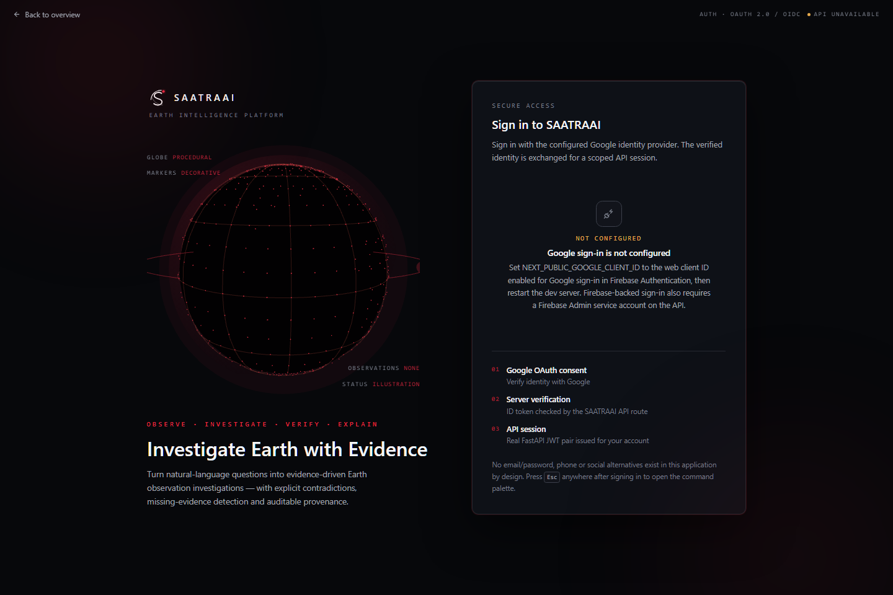

<div align="center">
  
  <h1>SAATRAAI</h1>
  <p><strong>Investigate Earth with evidence.</strong></p>
  <p>An evidence-first workspace for temporal Earth observation investigations.</p>
</div>

<p align="center">
  <a href="#what-is-saatraai">Overview</a> ·
  <a href="#architecture">Architecture</a> ·
  <a href="#investigation-flow">Investigation flow</a> ·
  <a href="#run-locally">Run locally</a> ·
  <a href="#screenshots">Screenshots</a>
</p>

---

## What is SAATRAAI?

SAATRAAI turns a place-and-time question into an auditable Earth observation investigation. It brings the area of interest, temporal scope, evidence plan, analysis status, and provenance into one workspace so people can inspect what supports a conclusion—and what is still missing.

The platform is being built incrementally. The interface includes a clearly labeled demo path; it does not claim that illustrative imagery or unavailable providers have produced real scientific findings. Real analysis depends on configured imagery providers, available data, and working model adapters.

### What the platform is designed to do

- Organize projects and investigations around a question, region, and date range.
- Record evidence plans, execution traces, sources, tool versions, and result status.
- Keep missing data and unavailable tools visible instead of filling gaps with invented observations.
- Help compare competing explanations while distinguishing observations from hypotheses and conclusions.
- Provide a responsive, dark workspace for maps, timelines, analysis, and reports.

## Architecture

The repository separates the web client, API, persistence, and optional model adapters. PostgreSQL/PostGIS is the transactional source of truth. Local filesystem object storage is the current development implementation; Redis is configured for future job processing. Satellite catalogs and Neo4j are not deployed integrations.



### Repository map

```text
SAATRAAI/
├── apps/
│   ├── web/                 Next.js app, landing page, workspace, map and UI
│   └── api/                 FastAPI routes, schemas, services and Alembic
├── infrastructure/         Local service and deployment support
├── ml/                      Optional model adapters and evaluation utilities
├── geospatial/              Geospatial processing components
├── graph/                   Evidence graph prototypes and related code
├── prompts/                 Prompt templates and research notes
├── datasets/                Dataset metadata and local dataset scaffolding
├── docs/                    Setup, workflows, implementation and QA records
└── docker-compose.yml       Local PostgreSQL/PostGIS and Redis services
```

## Investigation flow



An evidence plan is a planning aid; it does not fetch imagery or create scientific findings. When a provider, model, or input is missing, the corresponding work remains unavailable or inconclusive. Any result should be traceable to its input, tool, version, parameters, timestamps, and output artifact.

## Technology

| Layer | Current stack |
|---|---|
| Web | Next.js, React, TypeScript, Tailwind CSS |
| Visualization | MapLibre GL, Three.js / React Three Fiber, Recharts |
| API | FastAPI, Pydantic, SQLAlchemy, Alembic |
| Data | PostgreSQL, PostGIS, local development object storage |
| Supporting services | Redis configured for future background jobs |
| Identity | JWT API sessions; optional Firebase / Google sign-in integration |
| Model adapters | Optional local inference; weights and runtime are not bundled |

## Run locally

### 1. Start the local services

From the repository root, start PostgreSQL/PostGIS and Redis with Docker Compose:

```powershell
docker compose up -d
docker compose ps
```

Docker is optional. See [API operations](apps/api/README.md) for the local PostgreSQL/PostGIS and Redis setup without Docker.

### 2. Configure and start the API

In a new terminal from the repository root:

```powershell
Copy-Item .env.example apps/api/.env
Set-Location apps/api
python -m venv .venv
.\.venv\Scripts\python.exe -m pip install -r requirements.txt
```

Replace the development JWT secret in the private `apps/api/.env` with a unique local value, then migrate and start the service:

```powershell
.\.venv\Scripts\python.exe -m alembic upgrade head
.\.venv\Scripts\python.exe -m uvicorn app.main:app --reload --host 127.0.0.1 --port 8000
```

The liveness endpoint is `http://localhost:8000/health`; the interactive API documentation is at `http://localhost:8000/docs`.

### 3. Configure and start the web app

In another terminal, from the repository root:

```powershell
Copy-Item apps/web/.env.example apps/web/.env.local
Set-Location apps/web
npm install
npm run dev
```

Open `http://localhost:3000`. The API origin is configured through `NEXT_PUBLIC_API_URL`; configure authentication values only in the appropriate private environment files. See [Local development and API setup](docs/local-development.md) for Firebase, database, migrations, and optional model setup.

## Current scope and scientific integrity

- The local API, database, identity provider, and optional model runtime must be configured for their respective features to work.
- Demo screens are illustrative and must not be cited as real satellite observations.
- Missing imagery, unavailable providers, and unconfigured model weights remain explicit gaps; they are never represented as successful analysis.
- Satellite catalog providers, rainfall feeds, Neo4j, and production job workers are not deployed by the local Compose stack.
- No backend deployment target is currently configured for this repository.

For implementation detail, see [API operations](apps/api/README.md), [remote-sensing workflows](docs/remote-sensing-workflows.md), and [local development](docs/local-development.md).

## Screenshots

Current local UI preview. The globe is illustrative, and the status labels reflect the local configuration used when the screenshots were captured.

### Landing page



### Mobile landing page



### Sign-in experience


