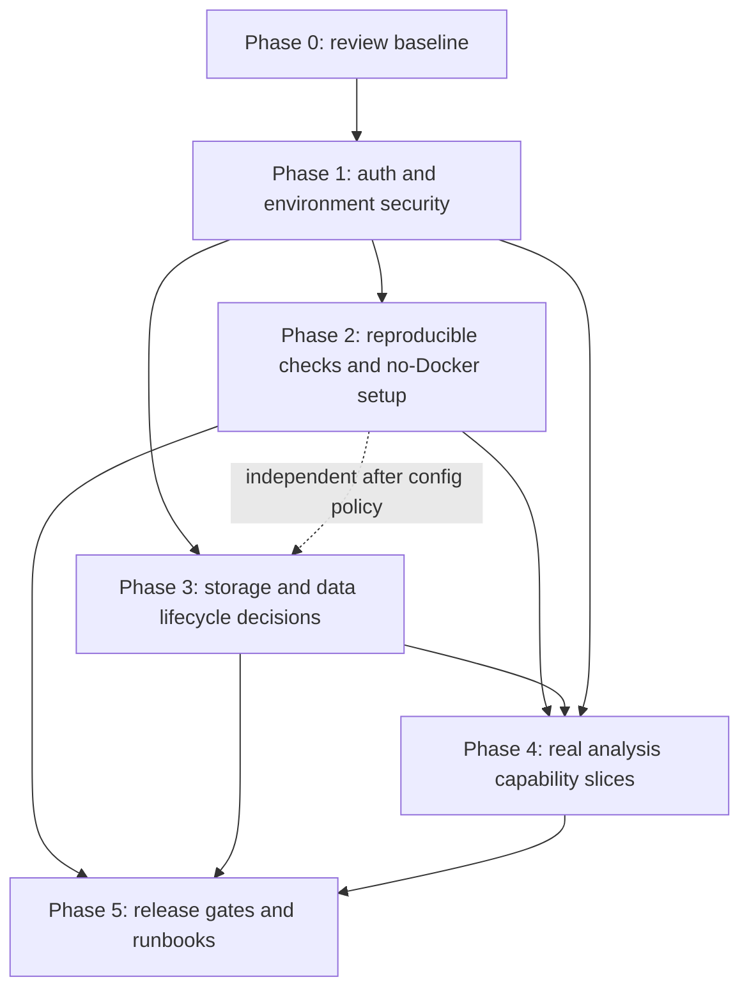

# SAATRAAI repository baseline and implementation plan

Audit date: 2026-10-23. Scope: source/configuration inspection only; no application code, schema, migration, production settings, or user data was changed. The existing uncommitted change to `apps/web/.env.example` was left untouched.

## Architecture and current behavior

- **Web:** Next.js 16 / React 19 application in `apps/web`; API clients and contract types are in `apps/web/src/lib/api`. A portion of the investigation experience uses explicitly marked simulated demo data (`apps/web/src/lib/demo/demo-data.ts`).
- **API:** FastAPI in `apps/api/app`; SQLAlchemy models in `app/models`, request/response schemas in `app/schemas`, service logic in `app/services`, routes in `app/api/routes`, and tool adapters/registry in `app/tools`.
- **Persistence:** PostgreSQL/PostGIS is the relational source of truth. Five Alembic revisions exist; documented head is `2f63ab0f6a5c`. Investigation configuration, queries, image metadata, tasks/model runs, hypotheses, evidence, conclusions, and reports have relational models. Raster/artifact bytes use `ObjectStorage`, currently `LocalObjectStorage` under `apps/api/data/uploads` when launched from `apps/api`.
- **Async/graph:** Redis is reachable/configurable but no job worker is present in the inspected runtime. Neo4j is deferred; there is no live graph integration.
- **Authentication:** Local email/password registration and login issue signed access/refresh JWTs. Firebase ID-token verification is supported when server credentials are configured. Protected routes use `get_current_user`; project/investigation services scope lookups by owner.
- **Analysis:** Deterministic query routing and a typed tool registry exist. GeoChat VQA/grounding need local model weights/runtime. Other listed adapters are placeholders which produce `NOT_IMPLEMENTED`. No satellite catalog or rainfall provider is configured. Demo records are marked simulated.
- **Deploy:** Web has Next.js/Vercel documentation and the repository identifies a Vercel site, but no deployment was performed or verified. API production hosting, persistent object storage, production database, origins, secrets, monitoring, backups, and worker topology were not established by source inspection.

## Development and verification commands

Run from the directory shown. API DB-backed tests require Python dependencies from `apps/api/requirements.txt` and an isolated reachable database configured for the process; current tests use the configured `SessionLocal`. Do not run them against production.

| Area | Command | Status / prerequisites |
|---|---|---|
| Web development | `npm run dev` (`apps/web`) | Declared in `apps/web/package.json`; requires npm install and suitable environment values for integrated flows. |
| Web lint | `npm run lint` (`apps/web`) | Declared ESLint script. |
| Web type check | `npx tsc --noEmit` (`apps/web`) | Available from the installed TypeScript dependency; no dedicated script is declared. |
| Web production build | `npm run build` (`apps/web`) | Declared; environment-dependent integrations may affect build/runtime. |
| API development | `python -m uvicorn app.main:app --reload --host 127.0.0.1 --port 8000` (`apps/api`) | Documented. |
| API tests | `python -m unittest discover -s tests -v` (`apps/api`) | Tests use `unittest` and FastAPI TestClient; backing database must be available. Pytest is not pinned or declared. |
| Migration state | `python -m alembic current` (`apps/api`) | Requires configured DB. |
| Apply migrations | `python -m alembic upgrade head` (`apps/api`) | Requires configured DB; use disposable/local DB during development. |
| Adaptation smoke | See `docs/adaptation-pipeline.md`, with dependencies in `ml/adaptation/requirements.txt` | Separate optional ML dependency environment. |

The repo does not declare a Python lint/type-check tool or a unified monorepo command. `docker-compose.yml` provides PostgreSQL/PostGIS 16/3.4 and Redis 7, but Docker is not the only possible local workflow; local compatible services may be used. `docs/local-development.md` currently documents Docker as its primary setup and should be updated to include non-Docker services/setup.

## API contracts and persistence

The API mounts under `/api/v1`; liveness is `GET /health`. Auth endpoints are `/auth/register`, `/auth/login`, `/auth/refresh`, and `/auth/firebase`; identity is `/users/me`. Projects and investigations support create/list/detail, with investigation configuration patching, persisted query create/list, and investigation delete. Image endpoints ingest/list images under an investigation. Execution endpoints create/list/get traces. Tools and system status are readable to authenticated users. Reasoning endpoints list persisted evidence, hypotheses, and conclusions. GeoChat VQA and grounding are authenticated upload endpoints.

Request and response contracts are Pydantic schemas in `apps/api/app/schemas`; the web mirrors these in `apps/web/src/lib/api/types.ts` and calls them through `resources.ts` / `reasoning.ts`. API error responses use an `{error: {code, message, details}}` envelope. Persistence is explicit in services: create/update/delete commits SQLAlchemy changes; local uploads are staged, promoted, and deleted on DB failure. Deleting an investigation cascades relational children while API docs state object artifacts remain for audit. The audit did not execute endpoints or inspect DB contents.

## Findings and defect register

Severity: **P1** blocks secure/credible deployment; **P2** materially affects reliability or integration; **P3** maintainability/developer clarity. “Confirmed” means directly established by source. Runtime assumptions require environment/deployment validation. Future capabilities are not defects by themselves.

| ID / class | Severity | Evidence | Affected area | Proposed fix | Acceptance test |
|---|---|---|---|---|---|
| D1 — Confirmed security/config defect | P1 | `apps/web/.env.example` contains a fixed `GOOGLE_BRIDGE_SECRET` value while the Google bridge route uses it for HMAC derivation (`apps/web/src/app/api/auth/google/route.ts`). A shared checked-in secret is not secret. Current `.env.example` also has an uncommitted user change; preserve it while resolving this item. | `apps/web/.env.example`; Google bridge route/docs | Replace the fixed value with an empty required placeholder, fail closed when unset, generate a per-environment secret, and rotate it if it was ever used outside local development. Do not print its value in logs. | Automated check rejects a non-empty bundled bridge secret; route returns explicit configuration failure when unset and accepts a valid verified identity only with configured secret. |
| D2 — Confirmed reliability/config defect | P2 | `apps/api/app/main.py` hard-codes only `http://localhost:3000` in CORS; docs say deployments must change it, but no environment setting exists. | API config, `main.py`, deployment docs | Add validated configurable exact-origin list with local default; document production origins. | CORS tests allow configured origin, reject unconfigured origin, and retain local dev behavior. |
| D3 — Confirmed developer workflow gap | P2 | `docs/local-development.md` requires Docker; only Compose services are supplied; no non-Docker database setup is documented. User constraint explicitly disallows mandatory Docker. | `docs/local-development.md`, root README | Document direct PostgreSQL/PostGIS and Redis installation/service alternatives, required extensions/versions, and point `DATABASE_URL`/`REDIS_URL` at them. | Follow the documented local workflow without Docker through migration, API health, and DB-backed test setup. |
| D4 — Confirmed verification gap | P2 | API has ten `unittest` test modules but no declared test command, pinned test requirements, or isolated test DB configuration; tests instantiate global `SessionLocal`. Web has lint/build scripts but no `typecheck` script. | API requirements/test setup, web package scripts, docs | Define reproducible isolated test configuration and documented commands; decide whether pytest or stdlib unittest is canonical; add an explicit web type-check script if agreed. | Clean environment can run the documented checks against disposable DB; a production DB URL is rejected by test setup. |
| D5 — Confirmed deployment visibility gap | P2 | `get_settings` enforces a non-default JWT secret for `ENVIRONMENT=production`, but only JWT secret has an explicit production validator; CORS and persistent storage/provider requirements are not validated. | `apps/api/app/core/config.py`, deployment setup | Validate production-critical config (secret strength/uniqueness policy, CORS origins, storage backend, Firebase as applicable); fail startup with actionable messages. | Config tests prove invalid/insecure production configurations fail before serving traffic. |
| D6 — Confirmed contract discrepancy | P3 | `docs/architecture/system.md` calls Next.js a connectivity page and excludes workspace UI, while current source contains authenticated workspace routes and UI. Root README/local docs are more current. | `docs/architecture/system.md` | Update architecture docs to reflect checked-in implementation and label deployed/runtime state separately. | Architecture statements map to current source and distinguish deployed from merely implemented capabilities. |
| D7 — Runtime assumption to verify | P1 | The checked-in `apps/api/data/uploads/objects` directory contains many raster and JSON objects; code uses local filesystem storage. Source does not establish whether these are disposable fixtures, user uploads, or production-shared data. | API storage/deployment and repository data policy | Establish provenance/ownership and whether files are tracked; then move runtime uploads out of source control and use persistent access-controlled storage for deployment. Preserve the data until ownership/retention is known. | Repository tracking and storage policy review; deployment restart/backup/restore proves uploaded objects persist and remain private. |
| D8 — Runtime assumption to verify | P1 | Existing Firebase login verifies an ID token and `email_verified`, then finds or creates a user by email (`apps/api/app/api/routes/auth.py`). The model has no Firebase UID/provider linkage visible in `identity.py`. Cross-provider linking and legacy account behavior are not tested. | API auth route, identity model/migration, auth tests | Review threat model and intended account-linking policy. Store provider subject identifiers and require an explicit safe linking path; do not silently bind identities based only on email without policy. | Tests cover verified/unverified identities, collision with local accounts, repeated login, and attempted cross-account linking. |
| D9 — Runtime assumption to verify | P2 | Local storage defaults to relative `data/uploads`; status reports path existence, not writability, capacity, durability, or backup. | API storage/status and production deployment | Confirm actual runtime volume and backup/retention policy. Introduce a storage abstraction implementation only when deployment requirements are decided. | Restart and restore checks on target environment, plus authorization tests for artifact access. |
| D10 — Future capability (not an implementation defect) | P1 before claiming full real analysis | Satellite optical/SAR providers, rainfall provider, Neo4j, asynchronous worker, and most task adapters are explicitly not configured/implemented; GeoChat weights/runtime are optional (`docs/local-development.md`, `app/tools/builtins.py`, status route). | Provider/model/job integrations | Prioritize real data sources and validated algorithms by use case; provide availability, provenance, and benchmarked uncertainty for each. Maintain unavailable states until acceptance criteria are met. | Provider-specific integration tests against recorded/replayable responses; scientific benchmark and provenance acceptance tests before enabling production capability. |
| D11 — Runtime assumption to verify | P2 | Frontend API client defaults URL and session handling; CORS is fixed; current branch deployment target and production environment values were not inspectable from repo. | Web/API deployment | Verify production API URL, CORS, auth token lifecycle, Firebase and OAuth origins, Vercel environment scopes, and secrets through deployment configuration review. | Staging end-to-end sign-in and owned-resource lifecycle with browser/network checks; confirm no secrets in client bundle. |

## Prioritized phased plan

| Phase | Tasks and dependencies | Likely affected files | Risks | Test commands / acceptance criteria |
|---|---|---|---|---|
| 0. Baseline review (this deliverable) | Review the defect register, unresolved decisions, ownership, and work sequencing before broad implementation. | `AGENTS.md`, `docs/implementation-plan.md` | Avoid treating demos or source presence as deployed capability. | Review these docs; no product implementation changes. |
| 1. Security and environment baseline | Resolve D1 and D8 policy; configure CORS (D2); define and validate production settings (D5); inspect deployment settings (D11). Depends on decisions below. | `apps/web/.env.example`, Google bridge route, API auth/config/main, auth tests, deployment docs | Secret rotation and auth migration may affect current users; origins can break sign-in. | API `python -m unittest discover -s tests -v`; web `npm run lint`, `npx tsc --noEmit`, `npm run build`; security tests for auth, CORS, startup config. |
| 2. Reproducible development and CI checks | Resolve D3/D4, add non-Docker local service workflow and isolated DB test setup. Can proceed independently of Phase 3 after basic config policy. | `docs/local-development.md`, `README.md`, API test/config files, `apps/api/requirements.txt`, web `package.json` | Test setup must never target production; adding tools adds maintenance. | Documented non-Docker path; run API tests on disposable PostGIS DB; web lint/type/build commands from clean install. |
| 3. Data lifecycle and production persistence | Resolve D7/D9 data provenance and retention; decide persistent storage/backup contract. Depends on deployment topology and privacy policy. | API storage service/config/status, deploy config/docs; possible migrations only if metadata contract changes | Moving objects without a verified inventory risks data loss or broken `storage_location` references. | Inventory/reconciliation; migration/copy verification and rollback; restart/backup/restore and ownership tests. No destructive cleanup before owner/retention decision. |
| 4. Real analysis capability slices | Select one provider/model/workflow; define scientific validation and provenance acceptance criteria first. Add provider, algorithms, background jobs only as needed. Depends on Phase 1 config and Phase 3 storage; individual integrations can be parallel after API contracts are assigned. | `apps/api/app/tools`, `services/orchestration.py`, schemas/models/migrations, `ml`, web API types/UI only with coordinated ownership, docs | Paid providers, model license/weight terms, compute cost, uncalibrated outputs, integration instability. | Provider/model availability tests, reproducible benchmark/evaluation, provenance checks, and explicit unavailable behavior when prerequisites fail. No fabricated fallback results. |
| 5. Documentation and release gates | Update stale architecture docs (D6), document operational runbooks, secrets, migrations, backup/restore, monitoring, release rollback. Depends on settled deployment topology. | `docs/architecture/*`, `docs/local-development.md`, root README, release/CI config | Docs can drift unless release gates validate them. | All claimed commands run; schema migration tested on disposable DB; staging owned-data workflow and scientific disclosure reviewed; deployment only under explicit authorization. |

## Dependency graph

Phase 2 and the data inventory/decision portion of Phase 3 can be investigated in parallel after Phase 1 security defaults are agreed. Provider-specific tasks in Phase 4 can run in parallel only when each has a named owner and coordinated schemas/API contract. Frontend implementation ownership must be explicitly assigned before editing `apps/web/src`.

## Environment, secrets, integrations, and unresolved decisions

Required for a local API: `DATABASE_URL`, `JWT_SECRET_KEY` outside production defaults, and a reachable PostgreSQL/PostGIS service. Redis is configured, but no worker was found. `LOCAL_STORAGE_PATH` and `MAX_UPLOAD_BYTES` control local ingestion. Firebase sign-in requires `FIREBASE_PROJECT_ID` and server-only Admin credentials/path; web Firebase client config is public configuration. The Google bridge additionally requires server-only `GOOGLE_CLIENT_ID` and `GOOGLE_BRIDGE_SECRET`. GeoChat requires a separately obtained compatible checkpoint, runtime dependencies, and `GEOCHAT_MODEL_PATH`; weights are not downloaded by this code. Never surface actual secret values in issue text or logs.

Unresolved decisions (do not silently infer):

1. Is the checked-in Google bridge secret template value ever used in a deployed environment? Who will rotate it and which environments rely on the bridge?
2. What is the intended account-linking policy for password and Firebase sign-in, especially when the verified email matches an existing local account? Are local registrations email-verified today?
3. What exact production origins, API host, deployment platform, database, and deployment owner are authoritative? Does the linked Vercel site serve this branch/revision?
4. Are files in `apps/api/data/uploads/objects` fixtures, developer artifacts, or retained user data? Who owns them and what retention/backup obligation applies? Do not delete or rewrite them before answer.
5. What non-Docker PostgreSQL/PostGIS and Redis versions/install path should be officially supported, and which environments must run the DB-backed suite?
6. Should stdlib `unittest` remain canonical or should the project add/pin pytest? Which Python lint and type-check tools, if any, are required in CI?
7. What first real workflow is in scope: optical catalog, SAR, rainfall, uploaded-image VQA/grounding, or another? Which providers, licensing terms, budget, latency, and regions are acceptable?
8. Which model checkpoint/license and hardware budget are approved for GeoChat? What benchmark dataset, calibrated uncertainty method, and scientific sign-off define production acceptance?
9. Is Redis intended for Celery/RQ/another worker, or should the job architecture be selected later? Is Neo4j still desired, given PostgreSQL relations currently serve reasoning reads?
10. What artifact access, deletion, retention, export, and user-requested erasure behavior is required? Current investigation deletion retains blobs by design.
11. Who owns frontend implementation and the active uncommitted change in `apps/web/.env.example`? Coordinate before touching those files.
